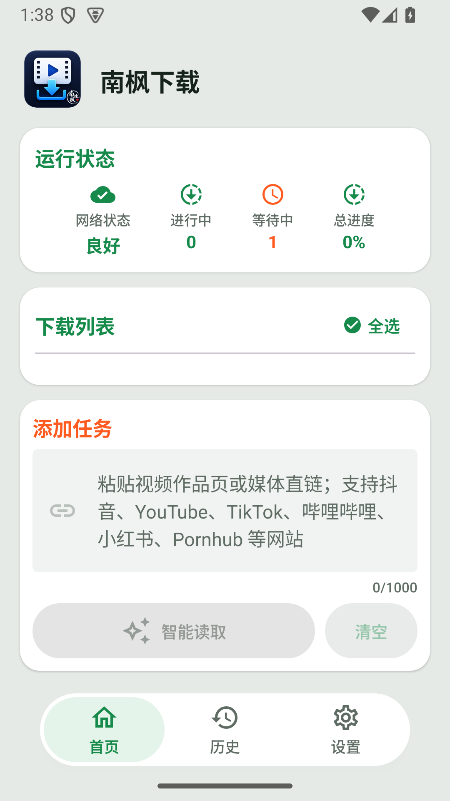
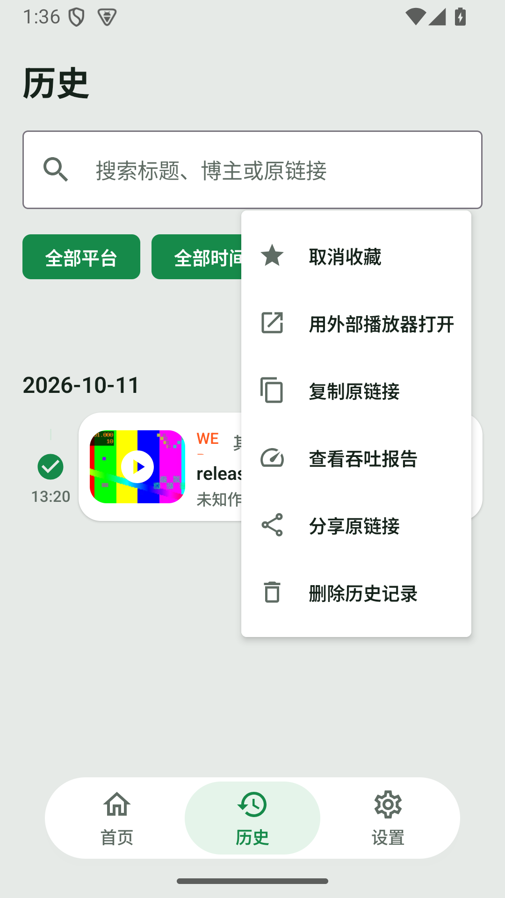
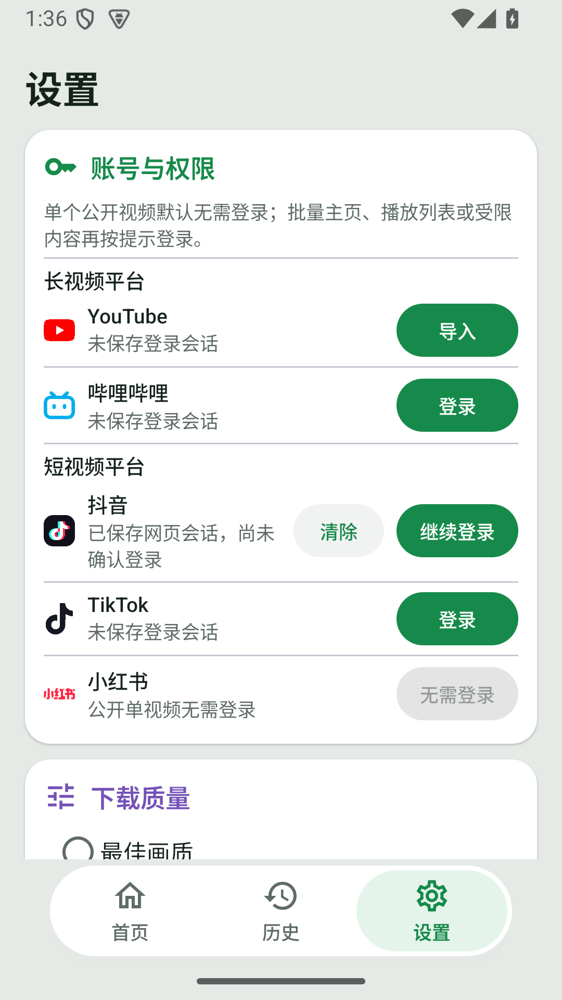

# 南枫下载 Android

Android 视频下载工作台，支持链接读取、下载队列、系统媒体库保存、历史收藏和内置播放。

[下载 v1.2.146 正式版](https://github.com/nanzhufeng/NanfengDownload-Android/releases/tag/v1.2.146) · [源码](https://github.com/nanzhufeng/NanfengDownload-Android) · [项目状态](docs/PROJECT_STATUS.md)

## 界面预览

| 首页 | 收藏与操作菜单 | 设置 |
| --- | --- | --- |
|  |  |  |

截图来自 v1.2.146 正式 APK 在隔离 Android 15 模拟器的正常运行页面，视口1080×2400、480dpi、字体1.0。演示媒体为合成测试片，不包含用户账号、会话或私人媒体；每张图对应一个真实页面。

## 功能

- 读取 YouTube、抖音、TikTok、哔哩哔哩、小红书，以及已接入的 Pornhub 单作品和通用 HTTP(S) 媒体页面；平台入口范围与实际验收见[网站审计](docs/verification/2026-10-10-five-platform-read-download-audit.md)。
- 按画质下载或导出 MP3，支持有界多连接、分段传输、续传、暂停、停止与失败重试；最终校验后保存到媒体库或所选目录。
- 后台通知和灵动岛显示真实任务进度，提供简洁／详细视图、原位缩放回弹切换及查看／停止操作。
- 历史视频收藏，支持关键词、平台和时间筛选；取消收藏保留视频文件。
- 内置视频播放器保存播放位置；左右双击快退／快进10秒，连续点击叠加，保持播放状态。
- 手机窄屏底部导航，展开屏使用双栏工作区；菜单统一配图标。

## 安装与边界

Release 附件使用稳定英文名 `NanfengDownload-Android-v1.2.146.apk`，附 SHA256 校验文件。本地正式构建产物保留中文名。长期正式签名相同的版本可保数据覆盖；签名不匹配时停止，禁止以卸载或清数据绕过。

只处理公开内容或用户有权访问的内容，不绕过付费、DRM或私密限制。读取与下载速度受平台、CDN、网络和账号条件影响，不承诺所有平台每次秒读或固定吞吐。OPPO已核验安装142与媒体元数据保留，146业务真机路径仍待用户验证；模拟器成功不能代替主设备或全部公网平台验收。

## 开发与验证

Kotlin / Jetpack Compose / Room11 / WorkManager / OkHttp / Media3 / Chaquopy / yt-dlp；Android 10及以上，compile/targetSdk35。

正式签名优先完整 `NANFENG_RELEASE_*` 环境变量；备用为仓库外用户级 Gradle 的 App 专属命名空间，不提交凭据。

```bash
cd android
./gradlew testDebugUnitTest testReleaseUnitTest lintRelease assembleRelease
```

产物：`android/app/build/outputs/apk/release/南枫下载-Android-v1.2.146.apk`。配置所需JDK、Python、NDK及签名后构建，详见[开发档案](docs/南枫下载%20Android%20完整开发档案.md)。宿主 Python 测试设置 `PYTHONDONTWRITEBYTECODE=1`，避免把宿主缓存写进Android依赖目录。

永久禁止 `connected*AndroidTest` 和主设备Debug／仪器部署。正式主设备覆盖只按用户授权核验同签名、递增版本和数据指纹。

## 文档

- [项目状态](docs/PROJECT_STATUS.md)：当前能力、门禁、验证缺口和同步情况。
- [当前交接](PROJECT_HANDOFF.md)：源码、冻结包与下一步边界。
- [146发布验收](docs/verification/2026-10-11-release-146.md)：续传修复、测试、包与GitHub交付证据。
- [后台灵动岛](docs/background-download-island.md) · [播放器](docs/video-playback.md) · [历史收藏](docs/history-favorites.md)
