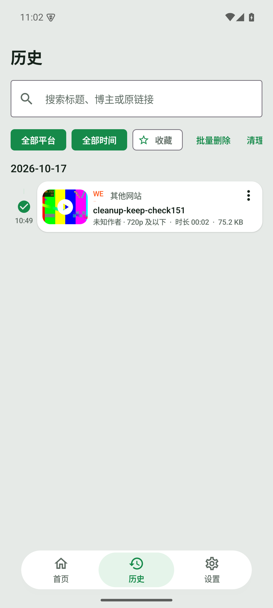
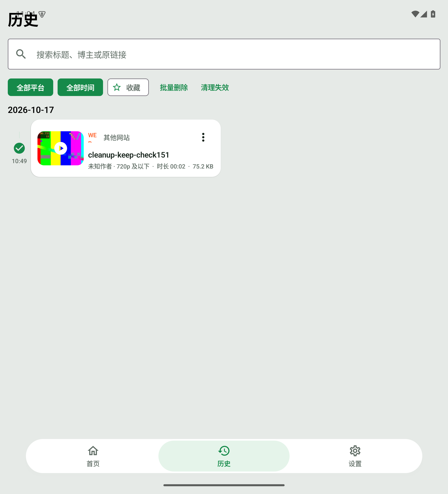

# 南枫下载 Android

Android 视频下载工作台，支持链接读取、下载队列、系统媒体库保存、历史收藏和内置播放。

[下载 v1.2.152 正式版](https://github.com/nanzhufeng/NanfengDownload-Android/releases/tag/v1.2.152) · [源码](https://github.com/nanzhufeng/NanfengDownload-Android) · [项目状态](docs/PROJECT_STATUS.md)

## 界面预览

| 手机历史与批量操作 | 展开屏历史工具栏 |
| --- | --- |
|  |  |

截图来自 v1.2.152 正式 APK 在专用隔离模拟器的正常历史页面：手机1080×2400/420dpi，展开屏2248×2480/442dpi，字体1.0；仅使用本机制备的测试视频，无用户账号或私人媒体。[截图与精确包对应信息](docs/screenshots/github-preview/v1.2.152.json)。

## 功能

- 本地视频预览使用多个时间点避开黑色片头，并更新旧预览缓存。
- 清理失效一次检查全部已完成历史，不受搜索或滚动限制；保留可读和无法确认的记录，不删除媒体文件。
- 平台、时间、收藏与批量删除、清理失效同排，窄屏横向滑动。

- 修复部分 HLS 视频因起始 AAC 时间戳被压为零而封装失败的问题，保留完整音视频样本。

- 新链接可直接粘贴替换旧输入；切换输入时取消旧读取，隔离迟到的页面捕获结果。

- 读取 YouTube、抖音、TikTok、哔哩哔哩、小红书，以及已接入的 Pornhub 单作品和通用 HTTP(S) 媒体页面；平台入口范围与实际验收见[网站审计](docs/verification/2026-10-10-five-platform-read-download-audit.md)。
- 按画质下载或导出 MP3，支持有界多连接、分段传输、续传、暂停、停止与失败重试；最终校验后保存到媒体库或所选目录。
- 后台通知和灵动岛显示真实任务进度，提供简洁／详细视图、原位缩放回弹切换及查看／停止操作。
- 历史视频收藏，支持关键词、平台和时间筛选；取消收藏保留视频文件。
- 内置视频播放器保存播放位置；左右双击快退／快进10秒，连续点击叠加，保持播放状态。
- 手机窄屏底部导航，展开屏使用双栏工作区；菜单统一配图标。

## 安装与边界

Release 附件使用稳定英文名 `NanfengDownload-Android-v1.2.152.apk`，附 SHA256 校验文件。本地正式构建产物保留中文名。长期正式签名相同的版本可保数据覆盖；签名不匹配时停止，禁止以卸载或清数据绕过。

只处理公开内容或用户有权访问的内容，不绕过付费、DRM或私密限制。读取与下载速度受平台、CDN、网络和账号条件影响，不承诺所有平台每次秒读或固定吞吐。OPPO已核验152同签名覆盖及媒体元数据保留，业务真机路径仍待用户验证；模拟器成功不能代替主设备或全部公网平台验收。

## 开发与验证

Kotlin / Jetpack Compose / Room11 / WorkManager / OkHttp / Media3 / Chaquopy / yt-dlp；Android 10及以上，compile/targetSdk35。

正式签名优先完整 `NANFENG_RELEASE_*` 环境变量；备用为仓库外用户级 Gradle 的 App 专属命名空间，不提交凭据。

```bash
cd android
./gradlew testDebugUnitTest testReleaseUnitTest lintRelease assembleRelease
```

产物：`android/app/build/outputs/apk/release/南枫下载-Android-v1.2.152.apk`。配置所需JDK、Python、NDK及签名后构建，详见[开发档案](docs/南枫下载%20Android%20完整开发档案.md)。宿主 Python 测试设置 `PYTHONDONTWRITEBYTECODE=1`，避免把宿主缓存写进Android依赖目录。

永久禁止 `connected*AndroidTest` 和主设备Debug／仪器部署。正式主设备覆盖只按用户授权核验同签名、递增版本和数据指纹。

## 文档

- [项目状态](docs/PROJECT_STATUS.md)：当前能力、门禁、验证缺口和同步情况。
- [当前交接](PROJECT_HANDOFF.md)：源码、冻结包与下一步边界。
- [152发布验收](docs/verification/2026-10-17-release-152.md)：预览、清理及工具栏优化，冻结包、主设备覆盖与GitHub交付证据。
- [后台灵动岛](docs/background-download-island.md) · [播放器](docs/video-playback.md) · [历史收藏](docs/history-favorites.md)

维护与升级先读[现行合同总入口](docs/contracts/README.md)，再核对PROJECT_STATUS与PROJECT_HANDOFF；项目根运行 `python3 tools/check_contracts.py` 检查合同路由/源码漂移。结构检查不替代业务验收。
